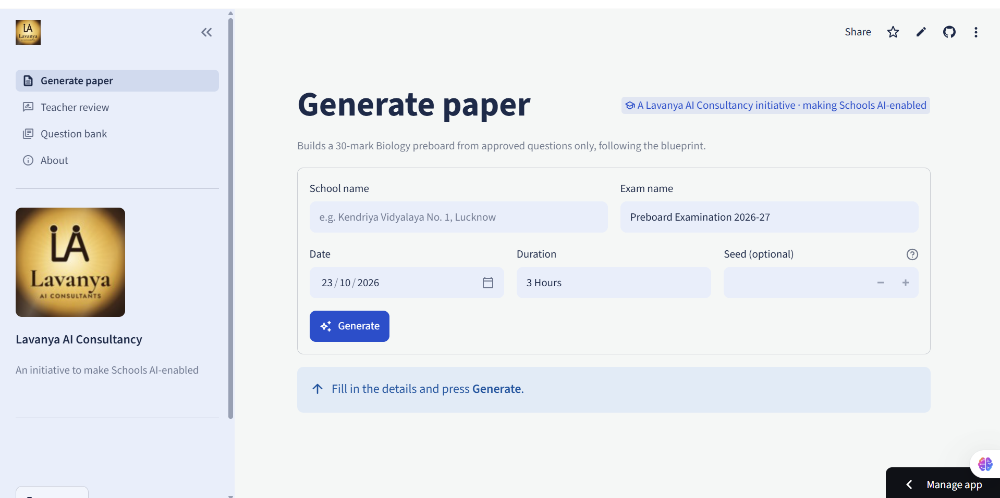
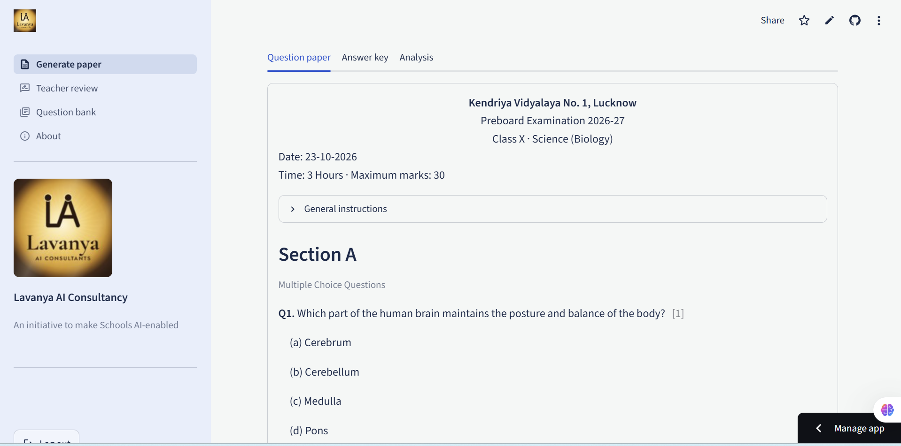

<p align="center">
  
</p>

<h1 align="center">Preboard Generator</h1>

<p align="center">
  <b>CBSE Class 10 Science (Biology) preboard papers in minutes – AI drafts, the teacher decides.</b><br>
  <i>A Lavanya AI Consultancy initiative to make Schools AI-enabled.</i>
</p>

<p align="center">
  
  
  
  
</p>



> Mermaid version and component list: [docs/ARCHITECTURE.md](docs/ARCHITECTURE.md)

## Live demo

**Live app:** [https://preboard-generator-2310-qpmeqm9tvb8cqjj2svebav.streamlit.app](https://preboard-generator-2310-qpmeqm9tvb8cqjj2svebav.streamlit.app) (password-protected – demo on request)

## Screenshots

| Generate a paper | The generated question paper |
|---|---|
|  |  |

---

## The problem → the solution

| | Before | With Preboard Generator |
|---|---|---|
| Time for one preboard paper | **4–6 hours** | **~15 minutes** (target) |
| Matching the CBSE pattern | Read the sample paper, count marks by hand | Blueprint built from the official 2026-27 sample paper |
| Question writing | From memory, guides, old papers | AI drafts new CBSE-style questions with marking schemes |
| Quality control | – | **The teacher approves every question** before it can appear in a paper |
| Answer key | Typed separately | Generated with step-wise marking, ready to print |

## How a paper is made

1. **Read the pattern** – the Pattern Agent studies the official 2026-27 sample paper, marking scheme and past board papers.
2. **Check the syllabus** – the Syllabus Agent compares the syllabus with the CBSE 2026-27 curriculum and NCERT (deleted / formative-only parts removed).
3. **Plan the paper** – the Blueprint Agent proposes marks per chapter and question types (~50% competency-based). The teacher approves.
4. **Draft questions** – the Question Agent writes new case-based, experiment, data, assertion–reason and real-life questions, saved as *pending*.
5. **Teacher review** – approve, edit or reject each question in the app.
6. **Generate** – one click builds the paper from approved questions only, with a question paper PDF (school header), an answer key PDF and an analysis of marks per chapter.

## Board pattern used (30-mark Biology preboard)

| Section | Question type | Questions | Marks each | Marks |
|---|---|---|---|---|
| A | Multiple choice | 7 | 1 | 7 |
| A | Assertion–Reason | 2 | 1 | 2 |
| B | Very short answer | 3 | 2 | 6 |
| C | Short answer | 2 | 3 | 6 |
| D | Long answer | 1 | 5 | 5 |
| E | Case-based (with sub-parts) | 1 | 4 | 4 |
| | **Total** | **16** | | **30** |

Marks per chapter: Life Processes 10 · Control and Coordination 6 · How do Organisms Reproduce? 7 ·
Heredity 4 · Our Environment 3. *(Starter blueprint – refined by the Blueprint Agent from the official SQP.)*

## Tech stack and cost

| Part | Tool | Cost |
|---|---|---|
| Language | Python 3.13 | Free |
| Web app | Streamlit | Free |
| Hosting | Streamlit Community Cloud | Free |
| Database (cloud) | Supabase (free tier) | Free |
| AI agents | Claude Code with instruction files – **no API key** | Included in an existing Claude plan |
| Agent tools | `cbse-paper-mcp` (official MCP Python SDK) | Free |
| PDFs | fpdf2 + DejaVu Sans font | Free |
| PDF reading | pypdf | Free |
| Code + diagram | GitHub (+ GitHub Pages) | Free |

## Run locally (Windows)

```
git clone https://github.com/lavanya1402/preboard-generator-2310.git
cd preboard-generator-2310
py -3.13 -m venv .venv
.venv\Scripts\python.exe -m pip install -r requirements.txt
copy .env.example .env        (then open .env and set APP_PASSWORD)
.venv\Scripts\python.exe -m streamlit run app.py
```

Open http://localhost:8501. Command-line paper: `.venv\Scripts\python.exe generate_preboard.py --seed 1`

Tests: `scripts\test_storage.py` · `scripts\test_mcp_server.py` · `scripts\test_app.py`

## Run the agents (no API key)

Register the MCP server once:

```
claude mcp add cbse-paper-mcp -- "<full path>\.venv\Scripts\python.exe" "<full path>\mcp_server\server.py"
```

Then open Claude Code in this folder and type:

| You type | What happens |
|---|---|
| `run agents/pattern_agent.md` | Downloads the 2026-27 SQP, marking scheme and past board papers from official CBSE sites, analyses the Biology questions, saves `pattern_report` |
| `run agents/syllabus_agent.md` | Checks the syllabus against the CBSE 2026-27 curriculum and NCERT, shows differences, updates only after you say yes |
| `run agents/blueprint_agent.md` | Proposes a new blueprint from both reports (~50% competency-based), shows the difference, updates only after you say yes |
| `run agents/question_agent.md for Life Processes, 10 case-based, medium` | Writes 10 new original questions with answers and marking schemes, saved as **pending** |

Recommended order the first time: pattern → syllabus → blueprint → question.
If a PDF cannot be downloaded, the agent lists it with the official page and the folder
(`data/sources/...`) to save it in. New questions are never used in a paper until the teacher approves them.

## Deploy

1. Push this repository to GitHub.
2. Create a free Supabase project, run `scripts/supabase_schema.sql` in its SQL Editor, then copy your data:
   `.venv\Scripts\python.exe scripts\migrate_to_supabase.py` (with `SUPABASE_URL` and `SUPABASE_KEY` in `.env`).
3. On [share.streamlit.io](https://share.streamlit.io): new app → this repo → branch `main` → main file `app.py` → Python 3.13.
4. In the app's **Secrets**, paste the lines from `.streamlit/secrets.toml.example` with your real values
   (`STORAGE = "supabase"`, `SUPABASE_URL`, `SUPABASE_KEY`, `APP_PASSWORD`) and deploy.

To update the live app later: edit → commit → push. Streamlit Cloud redeploys automatically.

## Project structure

```
app.py                  Streamlit app (password, 4 pages)
app_pages/              Generate paper · Teacher review · Question bank · About
papers.py               paper engine shared by the app, the MCP server and the CLI
storage.py              the only data layer (JSON locally, Supabase in the cloud)
pdfs.py                 question paper + answer key PDFs
mcp_server/server.py    cbse-paper-mcp (7 tools)
agents/                 instruction files for the 4 agents
data/                   syllabus, blueprint, question bank, reports
docs/                   ARCHITECTURE.md, architecture.html, architecture.svg
scripts/                tests, agent tools, Supabase migration, diagram generator
```

---

<p align="center"><b>Built by a CBSE teacher, for teachers. AI drafts, the teacher decides.</b><br>
© 2026 Lavanya AI Consultancy</p>
