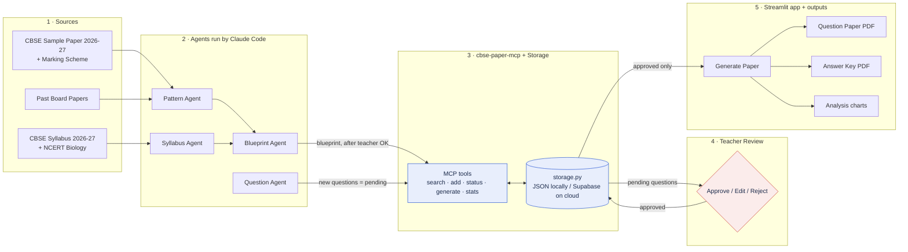

# Preboard Generator – Architecture

AI does the repetitive work (reading the CBSE pattern, drafting questions, assembling papers).
The teacher approves every question before it can appear in a paper.

## Components

| Part | File | What it does |
|---|---|---|
| Data | `data/*.json` | Syllabus, paper blueprint, question bank, agent reports |
| Storage | `storage.py` | The only code that reads/writes data. `STORAGE=json` (local files) or `supabase` (cloud) |
| MCP server | `mcp_server/server.py` | Tools Claude Code uses: search, add (always pending), approve/reject, generate paper, stats |
| Agents | `agents/*.md` | Step-by-step instructions Claude Code follows. No API key needed |
| App | `app.py` | Streamlit: password, Generate Paper, Teacher Review, Question Bank, About |
| CLI | `generate_preboard.py` | Same paper engine from the command line |

## Deploy later

GitHub (code + animated diagram) → Streamlit Community Cloud (app) → Supabase (data that survives restarts).
